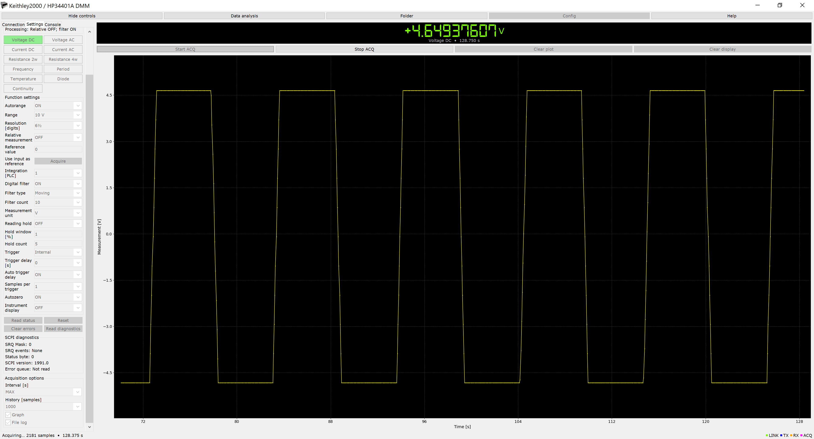
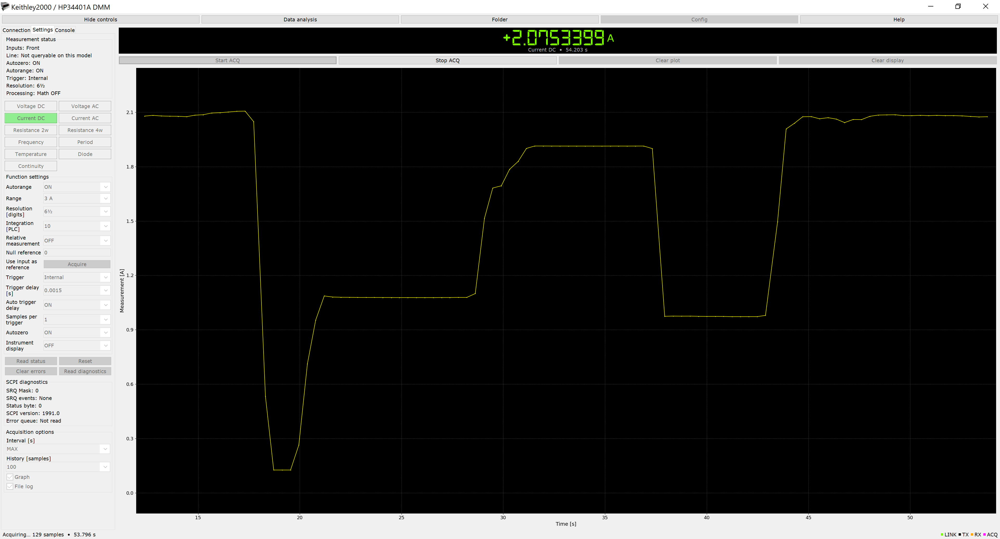
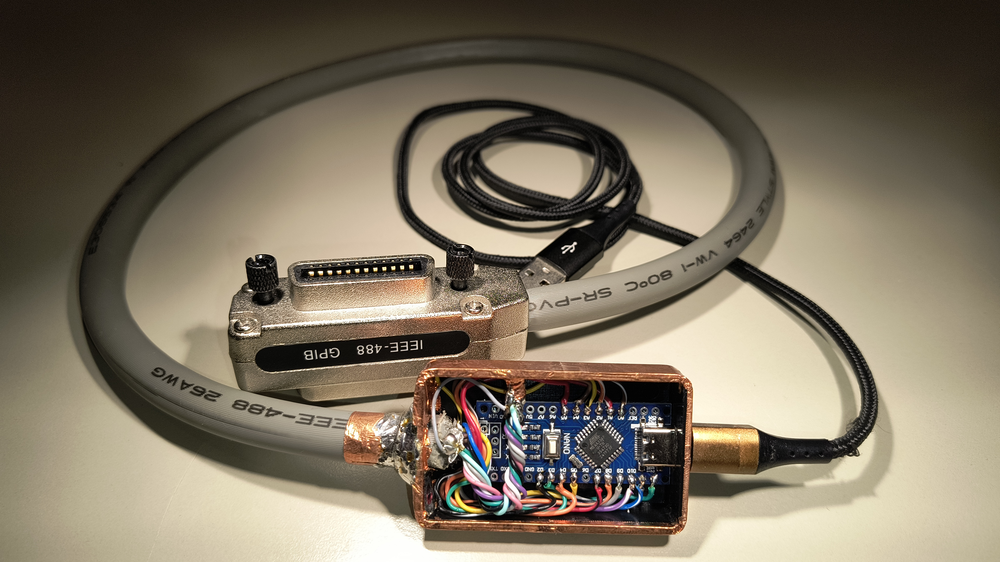
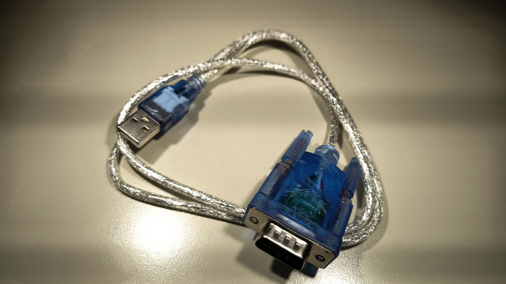
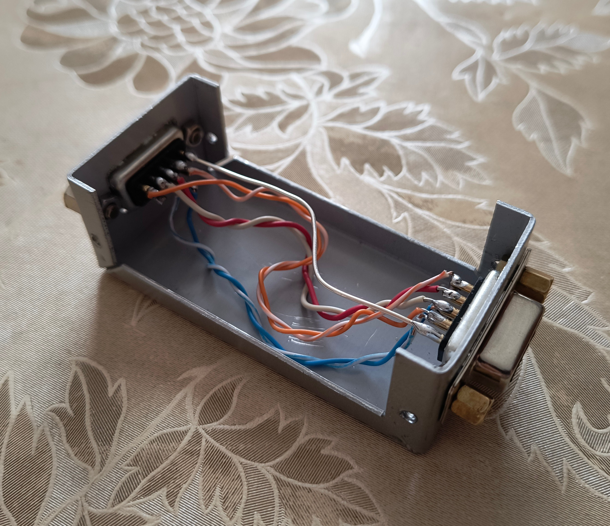
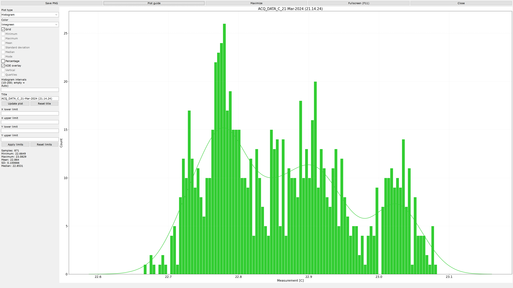

# Keithley2000 / HP34401A DMM GUI

A Python-based graphical user interface (GUI) designed to control and monitor 
the **Keithley 2000 and HP 34401A Digital Multimeters** via an **AR488 GPIB-to-Serial controller** 
or via an **RS232-to-USB Adapter**. 




## AR488 GPIB controller
To write and debug the GPIB interface, I built a GPIB controller using an Arduino 
Nano Clone CH340G and firmware provided by 
[Twilight-Logic](https://github.com/Twilight-Logic/AR488).



## RS232-to-USB Adapter
To write and debug the RS232 interface, I used a RS232-to-USB Adapter.
- The Keithley 2000 is configured as DCE (Data Circuit-terminating Equipment).
- The HP 34401A is configured as DTE (Data Terminal Equipment).

So the HP 34401A requires an additional adapter DCE-to-DTE (null-modem).  




## Install and run

Use Python 3.10 or later with Tkinter:

```bash
python -m pip install -r requirements.txt
python Main.py
```

Inspect either model without connecting hardware:

```bash
python Main.py --demo keithley2000 --no-sound --windowed
python Main.py --demo hp34401a --no-sound --windowed
```


## Connect and configure

The Connection tab discovers actual serial ports automatically and refreshes the list every two seconds. Select Model before connecting: changing it updates the available serial choices, resets serial parameters to the following application defaults and sets the GPIB address. The selected COM port, interface and timeout are retained. Identification with `*IDN?` still selects the driver for the connected Keithley Model 2000 or HP/Agilent/Keysight 34401A.

| Model | Baud rate | Parity | Data bits | Stop bits | Command terminator | XON/XOFF | RTS/CTS | DSR/DTR | GPIB address |
| --- | ---: | --- | ---: | ---: | --- | --- | --- | --- | ---: |
| Keithley 2000 | 19200 | None | 8 | 1 | CR | OFF | OFF | OFF | 16 |
| HP 34401A | 9600 | None | 8 | 1 | CR+LF | OFF | OFF | OFF | 22 |


The maximum selectable baud rate is 9600 for the HP and 19200 for the Keithley. HP parity can be None, Even or Odd; selecting Even or Odd automatically changes the data bits to 7, while None uses 8. The Keithley profile uses fixed 8N1 framing. Both profiles keep hardware RTS/CTS off; HP DSR/DTR and Keithley XON/XOFF can be enabled if required by the instrument configuration. The requested HP default uses one stop bit; two stop bits remain selectable to match the instrument's documented framing. Model and connection parameters cannot be changed while connected or while a connection operation is running.

- **RS232:** select the USB serial adapter and match the DMM's baud rate, parity, data bits, stop bits, flow control and command terminator. The receive parser independently accepts CR, LF, CR+LF and LF+CR, including fragmented replies.
- **GPIB (AR488):** select the COM port of the AR488 adapter and the instrument's GPIB address. This backend uses PyAR488 and the string-based `bus_write(command + "\n")` API. Controller version text uses `bus_read()`; DMM ASCII data uses `bus_read(decode=False)`. The GPIB profile configures controller mode only after the `++ver` handshake, then manual reading, LF termination, EOI and the controller read timeout. RS232 framing settings apply only to direct RS232.

If connection fails, Console and the error dialog identify the port, address, baud rate and failed stage. A response timeout defaults to one second. 
Four consecutive timeouts are accepted before disconnection. A correct response reset the timeout counter.

The selected interface must also be enabled on the instrument itself. Typical factory GPIB addresses are 22 for the HP34401A and 16 for the Keithley2000; select the address actually configured on your instrument.

Connect resets the instrument and initially disables its front-panel display (to reduce wear). The Keithley is configured for ASCII readings without appended units/status fields and finite, single-trigger operation. Disconnect resets the instrument, releases remote control and closes the serial port.

The Settings tab contains Inputs, Line, Autozero, Autorange, Trigger, Resolution and processing information. Function buttons turn green after successful readback. Only controls supported by the detected model and selected function appear. Temperature and thermocouple controls are available on the Keithley; HP AC current offers its supported 1 A and 3 A ranges. HP frequency/period use AC input voltage ranges and gate time.

Combobox and buttons interactions send settings immediately. Numeric entries and editable comboboxes send their value on Enter or focus loss, after validation. Status readback follows each change with a one-second settling interval in the worker thread. Programmatic synchronization does not send commands. Instrument settings are disabled during acquisition, preventing changes of function or unit inside a capture.

On the HP34401A, Digits is disabled while Autorange is ON and becomes selectable after an Autorange OFF readback. The driver also rejects a digits change in this state without sending a command. This restriction does not apply to the Keithley.

The HP does not provide the Keithley `DIGits` command. Its driver sets measurement resolution with `RESolution` and frequency/period precision with `APERture`; readback also reflects coupled integration changes. The Keithley uses the selected function's `DIGits` command.

The HP supports one math function at a time. Choosing dB/dBm replaces Null; enabling Relative replaces dB/dBm. HP dB reference is expressed in dBm and uses `CALC:DB:REF`, while Keithley dB reference is a voltage and uses `UNIT:VOLT:<DC|AC>:DB:REF`. Reference-junction controls use the full Keithley SCPI paths, including the selected simulated or real reference mode.

Read diagnostics displays the service-request mask, enabled event names, status byte, SCPI version and one error-queue entry. Routine status refreshes do not consume the error queue. HP line frequency cannot be queried using the Keithley `SYST:LFR?` command, so the label explicitly reports this limitation.

Custom command, its entry, Send and Read response are in the Console tab. Send or Enter submits an ASCII SCPI command. Queries containing `?` are read automatically; the checkbox also allows requesting a reply explicitly. All operations run outside the Tk event thread and are serialized as complete write/read transactions. A communication timeout closes the session so a late reply cannot be mistaken for the next query. The console identifies the stage of any connection failure.


## Acquisition and analysis

Start ACQ starts a scrolling waveform and the numeric display. History controls the number of visible samples; File log records every returned sample. MAX requests the next batch as soon as the previous one finishes. Numeric intervals specify the delay schedule between batches. Stop completes the current query and batch before finishing.

For Bus trigger, the driver sends INIT, *TRG and FETC?. External trigger waits for the hardware trigger. Multiple values returned by one query are all retained; none are discarded. Because these devices do not provide per-sample timestamps in this reply format, all samples in a batch receive its host receive time. The program does not invent hardware timestamps.

Data Analysis loads a CSV format file, `MEASURE[unit],TIMESTAMP[s]`. Line, Histogram, KDE, Box and Violin are available. Controls remain visible in a scrollable panel. The window can be maximized or made fullscreen with F11; Escape leaves fullscreen. Resize events are coalesced and moving the window does not rebuild the figure. Plot fonts follow the button text's rendered size. PNG export uses a separate export resolution without increasing the interactive canvas resolution.


For Line, minimum, maximum, mean and sample standard deviation use the original samples inside the applied X bounds, Y bounds or their intersection. Edges are included. Empty selections are explicitly reported. Reset limits restores the complete capture. Changing plot type clears both committed limits and the four limit entries.

The main window allocates most available space to the waveform. Controls reflow on smaller screens and scroll when necessary. Entries and comboboxes share the label font, including dropdown lists. Digital-7 is rendered from the included TrueType file without requiring a system font installation.


## Modules

| Module | Main responsibility |
| --- | --- |
| Main.py | Arguments and application startup |
| app.py | Composition and GUI actions |
| drivers.py | ScpiModelDriver, HP34401ADriver, Keithley2000Driver, DriverFactory |
| instrument.py | ScpiMultimeter, serialized queries, readback and measurement parsing |
| transport.py / ar488.py | ConnectionOptions, RS232Transport, AR488Transport, TransportFactory |
| connection_profiles.py | Model-specific serial choices, defaults and GPIB addresses |
| models.py / config.py | Immutable snapshots, setting validation and function definitions |
| layout.py | Geometric policies and scale-ratio calculations |
| widgets.py | Reflowing buttons, command row and scrolling controls |
| connection_ui.py / settings_ui.py / ui.py | Connection form, dynamic settings and application panels |
| acquisition.py / tasks.py | Sampling and background workers |
| plot.py / display.py | Scrolling waveform and Digital-7 readout |
| analysis.py / analysis_ui.py / canvas.py | Statistics, analysis controls and efficient resizing |
| ports.py / storage.py / dialogs.py | Port discovery, CSV/preferences, themes and secondary windows |
| simulation.py | Both demo models |

Captures are stored in `<Program Path>/Keithley2000_HP34401A_DMM/OUTPUT`; PNGs are stored in its `PLOTTER/<plot type>` subfolder. The directory name is independent of the application title, so its slash cannot create an invalid Windows path.


## Unit Testing

```bash
python -m unittest discover -s tests -v
```
- `test_analysis_window` -> 12 Tests
- `test_application` -> 8 Tests
- `test_connection_profiles` -> 4 Tests
- `test_data` -> 20 Tests
- `test_gpib_framing` -> 8 Tests
- `test_scpi` -> 17 Tests
- `test_timeouts` -> 11 Tests


## Protocol references
- [Keithley2000 user's manual](docs/2000-900_J-Aug2010_User.pdf)
- [Keithley2000 datasheet](docs/2000-DMM-Data-Sheet-1KW612970.pdf)
- [Keithley2000 instruction manual](docs/2000SCAN-901-01_F-Jan-2014.pdf)

- [HP34401A user's guide](docs/34401A_User's_Guide.pdf)
- [HP34401A service guide](docs/Agilent-HP_34401A_Service_Guide.pdf)

- [AR488 developer manual](https://twilight-logic.github.io/AR488/)


## Driver dependency
- [PyAR488](https://pypi.org/project/PyAR488/)

- Digital-7's license is included in DIGITAL7_FONT_LICENSE.txt.


### License
This project is licensed under the **MIT License** - see the `LICENSE` file for details. 
You are free to use, modify, and distribute this software, even for commercial purposes, 
as long as the original copyright notice is retained.


### Contributions
Contributions, bug reports, and hardware compatibility feedback are highly appreciated! 

Since the codebase has been structured with independent, decoupled classes (protocol, 
transport, acquisition, etc.), please maintain this clean object-oriented architecture 
when submitting changes.

* **Reporting Bugs**: Open an **Issue** on the repository. If you experienced a communication 
failure, please copy and paste the exact *Connection failed…* message from your Console to 
help distinguish serial/controller issues from DMM handshake errors.
* **Submitting Code**: **Fork** the repository, create a dedicated feature branch, and submit 
a **Pull Request**. For major architectural changes, please open an Issue first to discuss 
your proposal.